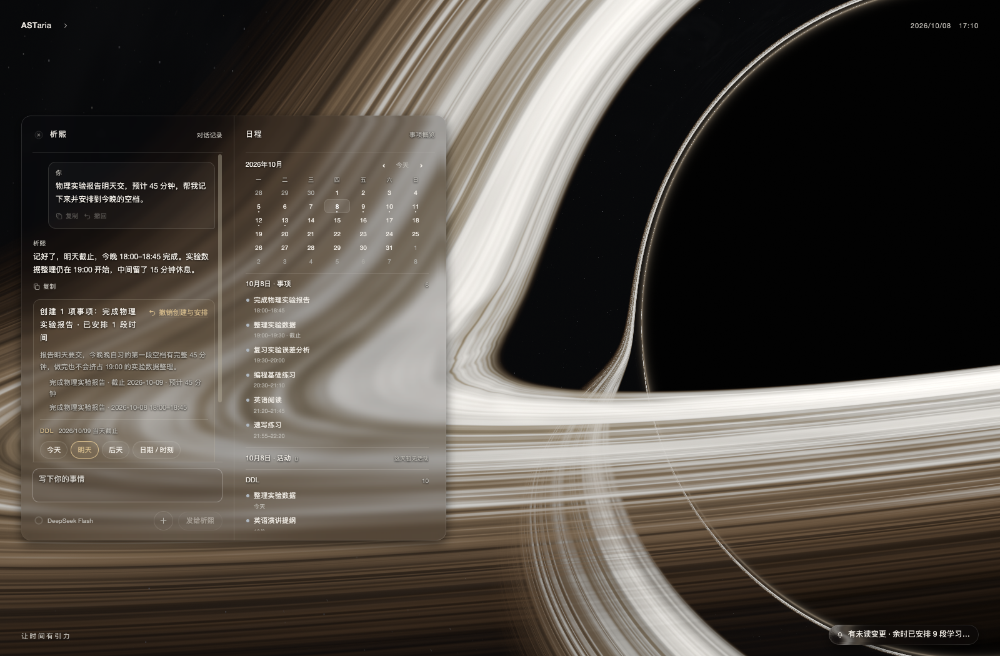
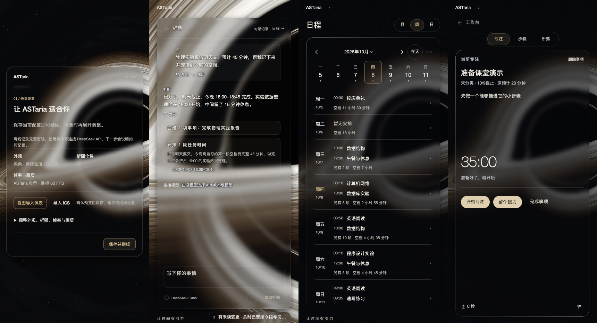
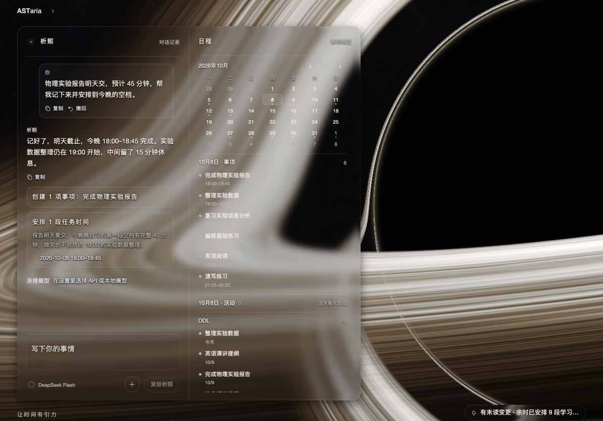
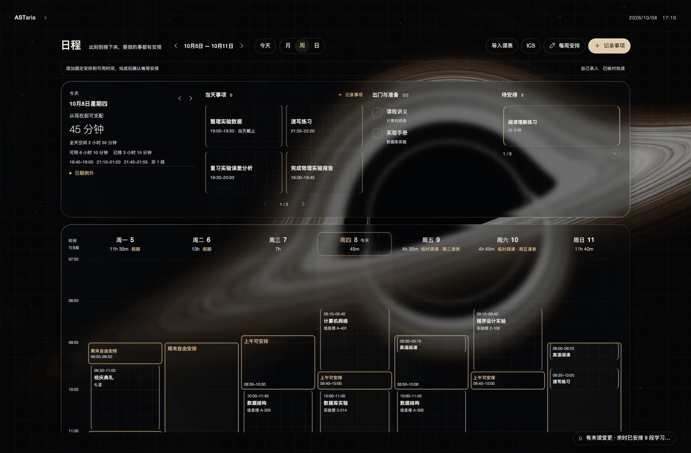
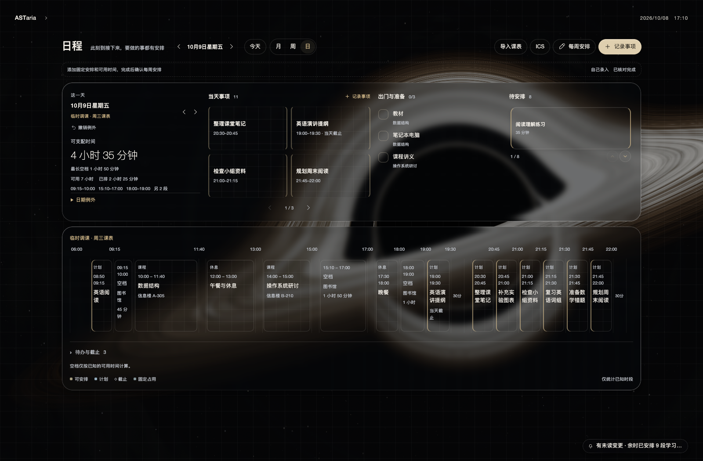
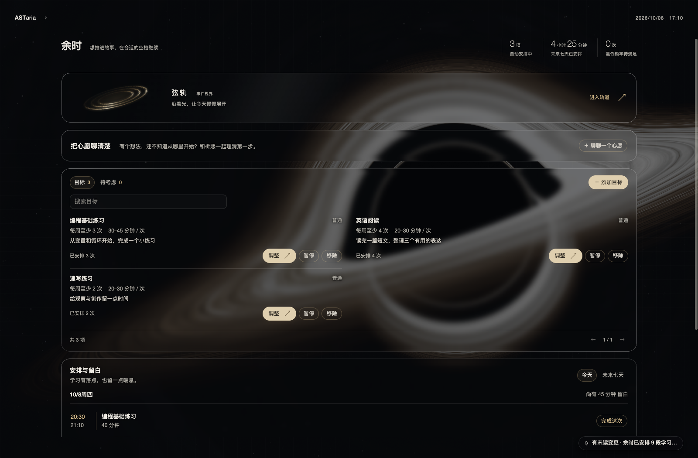
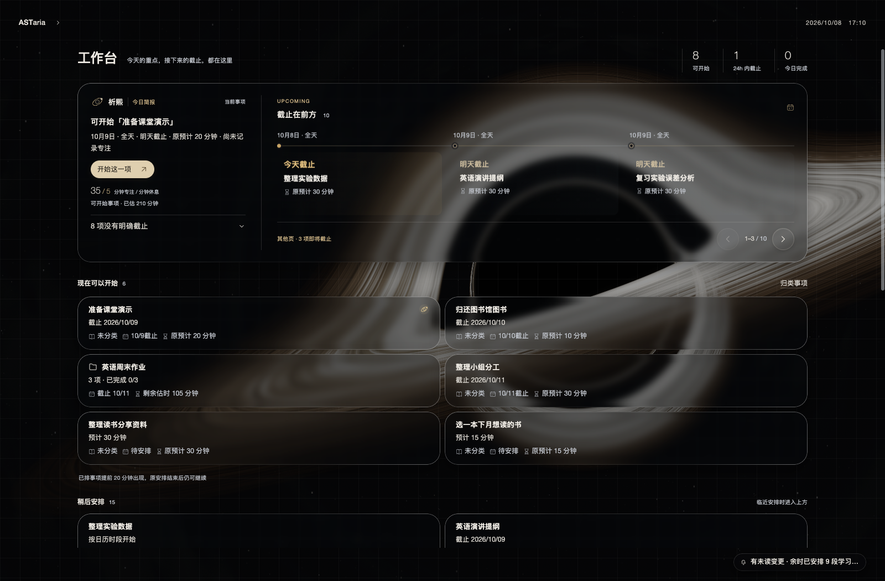
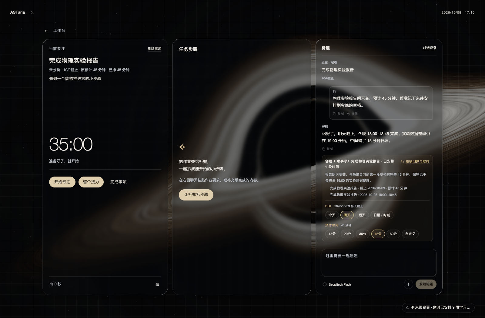

# ASTaria

**让时间有引力**

你是否也有过被几十个DDL追着的经历
如果你和我一样被事情搞得晕头转向，老是忘记or不知道先干什么
或许可以试试让ai帮你安排你的事项？
基于这个想法我制作了ASTaria～一款本机优先的个人时间与事项应用。和析熙聊作业、计划或心愿，把任务放进课程和日常活动之间的真实空档，再从工作台开始专注。
可以去官网看看，了解一下：https://astaria.space

[官方网站](https://astaria.space) · [官网源码仓库](https://github.com/Wason-dev/ASTaria-website)

## v1.0.0

ASTaria 将事项、课表、日程和专注放在同一个空间里。你可以告诉析熙要做什么、什么时候交，由她结合已有安排找到真实空档，并在回执中说明安排理由。

**v1.0 首次推出 Android 与 iOS，覆盖 Android 手机、iPhone 和 iPad，并继续提供 macOS 与 Windows 桌面版。** 当前源码版本为 **1.0.0**，正式安装包尚未发布；目前公开下载仍为 Beta12.1。

[发布说明](docs/releases/v1.0.0.md) · [安装说明](INSTALL.md) · [更新记录](CHANGELOG.md) · [功能详情](docs/guides/FEATURES.md) · [当前公开下载：Beta12.1](https://github.com/Wason-dev/ASTaria/releases/tag/v0.1.0-beta.12.1)

- **说完就能继续做事。** 析熙可创建事项、记录活动和安排时间；回执展示真实保存结果，支持修改截止日期、预估时长与撤销。
- **安排有依据。** 结合课程、活动、可用时间与事项之间的关系安排任务。复习可以关联到考试开始之前；相关日期变更后重新检查安排，无法完成时说明约束。
- **同主题事项收在一起。** 多份作业可归入事项集合，首页与工作台保持简洁，每份仍独立估时、安排和完成。
- **文档也能带进对话。** 支持图片、PDF、Word 和表格文件，回复支持数学公式与表格；上下文小窗展示实际带入的历史、资料与输出。
- **为不同设备组织界面。** 手机专注页可在计时、步骤与析熙之间横向切换；平板与桌面利用横向空间。首次设置提供快捷配置、课表导入和可收起的操作导览。
- **选择适合设备的背景。** 实时渲染、1080p 高码率视频与 4K 静态图可切换；视频背景保留思考微光与弦轨效果。可选 4K 视频资源尚未开放下载。

## 看看 ASTaria

以下截图展示 v1.0 界面，使用虚构演示数据，不包含个人课表、聊天或密钥。截图中的回复由演示脚本提供，事项、排程和回执通过实际业务流程保存。

**从一句话到一段安排。** 实验报告明天截止，析熙把它安排到今晚 18:00–18:45，并说明与已有日程的关系。回执可修改截止和估时，也可撤销创建与安排。

**黑洞首页。** 收起对话，保留当前事项与析熙入口。

**手机与平板。** 首次设置、聊天、日程和专注沿用同一套视觉语言，并按屏幕宽度组织内容。

**日程周视图。** 课程、单日活动、任务、假期与临时调课在同一周展示。

**调课当天。** 查看替换后的课程、地点、已排任务与剩余空档，无需修改整周模板。

**余时。** 为编程、阅读和速写等持续目标保留频率、时长与实际安排记录。

**弦轨。** 在真实日期上查看分组、调整顺序和换天，安排受到已有占用与截止日期约束。

**工作台。** 从可以开始的事项进入专注，同时查看近期截止、任务进度和建议依据。

**专注中的析熙。** 当前事项、任务步骤和对话并列显示，附件入口与首页保持一致。

## 安装与更新

v1.0 的安装包尚未公开。当前可从 [Beta12.1 Release](https://github.com/Wason-dev/ASTaria/releases/tag/v0.1.0-beta.12.1) 下载 macOS 13+ Apple Silicon 版和 Windows x64 版；它们不包含本文展示的全部 v1.0 功能。请按[安装说明](INSTALL.md)选择对应文件并核对 SHA-256。

v1.0 继续提供 Mac 与 Windows 桌面版，并首次提供 Android 与 iOS。Mac 正式分发使用 Developer ID 签名与 Apple 公证，Android 使用 release 签名；iOS 的 TestFlight 或 App Store 入口将在可用时公布。上述分发流程尚未完成，当前没有移动端公开下载或 TestFlight 邀请。

Windows 继续提供安装程序与便携 ZIP，EXE 尚未进行 Authenticode 签名。Windows 实机验证尚未完成，安装、交互、升级与回退的兼容性仍有待确认。

macOS 与 Windows 标准安装版支持在「设置 → 通用 → App 更新」检查更新，并验证发布清单与文件校验值。便携版及非标准安装位置需手动更新。Beta12.1 的 Mac 客户端识别正式签名包时存在旧版本限制，升级到 v1.0 请从官方发布页下载。更新前建议导出备份。

## 首次使用

1. 选择外观、玻璃、帧率与画质，也可以先保留推荐设置。
2. 导入课表或录入课程、活动和可用时间；ICS 导入在本机完成，截图识别需要支持图片的模型。
3. 连接模型后与析熙对话。模型连接可以稍后设置，离线记录事项和日程无需 API Key。

桌面支持 DeepSeek、其他 OpenAI 兼容 API 服务，以及自行部署的 Ollama、LM Studio 等本地模型；移动端目前支持 DeepSeek API。API 服务按供应商规则计费，与聊天会员分开；工具调用和图片理解取决于所选模型。

## 数据与隐私

事项、日程、对话、附件和记忆保存在本机。macOS 与 iOS 的 API Key 使用系统钥匙串，Windows 使用 DPAPI，Android 使用 Android Keystore。密钥不进入业务备份或同步文件。

使用云端模型时，请求所需的上下文和附件会发送给所选服务；本地模型需自行运行。联网搜索默认关闭，开启后使用 DeepSeek 官方服务；网页内容作为资料读取，不能授权修改本机数据。具体网络与存储边界见[安全与隐私说明](SECURITY.md)。

桌面可通过共享文件夹或已配置的 Syncthing 目录同步事项、课表、安排和目标。每台设备保留独立数据库，目录传递加密操作；聊天、附件、记忆与 API Key 不参与同步。移动端支持 JSON 备份分享与恢复，暂不提供目录同步，手机与电脑不会自动同步。

macOS 数据目录为 `~/Library/Application Support/ASTaria`，Windows 为 `%APPDATA%\ASTaria`，移动端使用应用私有目录。JSON 备份包含业务资料与附件，是未加密文件；请妥善保管备份与另存的同步恢复密钥。系统提醒需要授权，实际送达受设备、省电和专注模式影响。

## 功能与隐私

产品功能、数据保护与安装步骤分别见[功能说明](docs/guides/FEATURES.md)、[安全与隐私说明](SECURITY.md)和[安装说明](INSTALL.md)。

问题请提交 [Bug report](https://github.com/Wason-dev/ASTaria/issues/new?template=bug_report.yml)，附版本、系统和复现步骤，避免上传密钥、课表或私密聊天。

## 许可

源码采用 [Apache-2.0](LICENSE)，第三方组件保留各自许可，见 [THIRD_PARTY_NOTICES.txt](THIRD_PARTY_NOTICES.txt)。许可证不授予 ASTaria 名称与标识的商标使用权，见 [NOTICE](NOTICE)。
